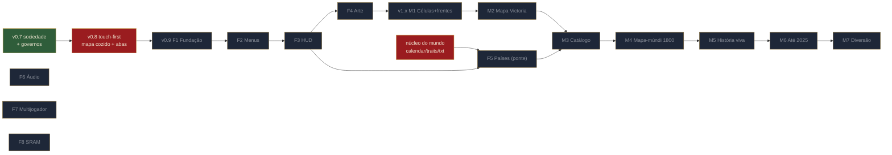

# ROADMAP.md — OH MY VICTORIA DS!

> **O que é este documento:** o mapa do trabalho *no tempo*. Ele **não** substitui o
> `DESIGN.md` (o *quê* e o *porquê*) nem o `docs/SDD.md` (o *como está no código*).
> Ele ordena as tarefas, diz o que está pronto **hoje**, o que falta e em que ordem.
>
> **Hierarquia:** em conflito de design, `DESIGN.md` vence; em conflito técnico, o
> `SDD.md` e as restrições do DS vencem. Este roadmap é sempre corrigido — nunca deixe
> os três se contradizendo.
>
> **Imagem:** `docs/roadmap.png` (gerada por `tools/roadmap_img.py`; edite o script,
> não o PNG).
>
> Status: **2026-10-16**, branch `feat/mundo`. Baseline do código: `make` verde
> (`ohmyvictoria_ds.nds`, 158 KB).

---

## 1. Onde estamos (baseline honesto)

| Camada | Estado | Evidência no repo |
|---|---|---|
| **v0.7** — sociedade + governos | **Jogável (feito).** | `source/*.c` da v0.7; SDD secs 1–10; SIM 200 dias + replay. |
| **v0.8** — touch-first (mapa cozido + abas de caneta) | **Em andamento no código, ainda não documentada.** | `include/ui.h`, `source/ui.c`, `source/px_ui.c`, `source/px_hud.c`, `source/px_map.c` (buffer-mundo 512x384); `source/px_tiles.c` removido; `source/input.c` caneta-first (pan + tap por tabela). |
| **Núcleo do mundo** (calendário, traits, catálogo, bandeiras, história, mundo celular) | **No código, ainda sem tela/ligação ao jogo** (testes de núcleo verde). | `calendar.c` (1800–2025, eras, Modo Eterno), `traits.c` (30 traits), `txt.c` (UTF-8 → 3x5), `nations.c` (catálogo), `px_flag.c` (bandeiras, ADR-19), `earth_mask.c` (terra real), `history.c` (história viva + eventos) e `world.c` (mundo celular com frentes, M1, ADR-18); `host/run_tests.sh` verde. Nenhum `.c` do jogo chama essa API ainda. |
| **v0.9** — UI da concept art | **Parcial: F1 (Fundação) em andamento**; telas F2+ ainda não. | Já no código: `pal.h` (tokens), `settings.c/h`, `str.c/h` (PT/EN), `px_art.c/h` (placeholder de arte), `px_font2.c` + `source/gen/font_data.c` (Serifa 8/12; preview em `docs/font_preview.png`) e `g->screen`/`enum Screen` no `types.h`. Contrato em SDD sec 14 (fases **F1–F8**). |
| **v1.x** — o mundo | **Planejada**, mas o **núcleo do M1 já existe** (mundo celular/frentes), ainda sem tela. | `DESIGN.md` sec 4–9 + ADRs 18–20; marcos **M1–M7**. |

Resumo visual (também em `docs/roadmap.png`):

**Leitura do grafo:** feche a v0.8 e o saneamento de docs (E0) → v0.9 (E1, F1→F8; o F5 liga
os traits/calendário já compilados) → v1.x (E3, M1→M7). O F5 é a **ponte**: leva o catálogo
de países para o mapa 32x24 atual antes do mundo celular.

---

## 2. Código x documentos (alinhado nesta entrega)

O código estava **à frente** dos docs em três pontos. Foram **corrigidos junto com este
roadmap** (2026-10-16) — um roadmap construído sobre docs desatualizados mente:

1. O cabeçalho do SDD dizia que `source/px_ui.c` "ainda não existe" e que a v0.8 era só
   `ui.h`/`ui.c`/`px_map.c`. **Hoje `px_ui.c` existe e é usado**, e `px_tiles.c` foi
   **removido**. Cabeçalho do SDD e `AGENTS.md` já refletem isso (sec 1 e 9 do SDD ainda não).
2. `DESIGN.md` sec 9 afirmava estarem "já implementados" `nations.c`, `px_flag.c`,
   `history.c`, `world.c` e `host/`. No instante do levantamento **nenhum existia** (só
   `calendar.c`, `traits.c`, `txt.c`); durante esta entrega um **segundo desenvolvedor**
   criou-os na branch `feat/mundo` (testes de núcleo verde em `host/`). O parágrafo do
   `DESIGN.md` sec 9 e o baseline da sec 1 refletem o estado REAL em 2026-10-16.
3. `DESIGN.md` sec 9 citava a **"SDD sec 15"** como fonte dos testes do núcleo. **Essa seção
   não existe** (o SDD termina na sec 14.10). Referência removida.

**E0.2 (parcial):** o **mapa de arquivos** do SDD sec 1 foi reescrito para a v0.8/v0.9 real
(`px_ui.c`/`px_hud.c`/`px_map.c`, buffer-mundo, input de caneta, e os arquivos novos da
v0.9), o cabeçalho da sec 14 marca a F1 e o `SAVE_VER` foi corrigido (61 → 63). **Falta:** o
corpo da sec 9 (render) e os `docs/diagramas/*.mmd` (ainda descrevem o `px_tiles.c`).

---

## 3. Fases

### E0 — Fechar e documentar a v0.8 (touch-first)

| # | Tarefa | Pronto quando |
|---|---|---|
| E0.1 | Playtest de 5 min da v0.8 no melonDS (mapa cozido, pan, abas OBRAS/MERCADO/REL./SIST., menu de caneta) | Sem travamento; pan sem rasgo; 60fps |
| E0.2 | Documentar a v0.8 no SDD secs 1 e 9 (arquivos reais, `px_ui.c`/`px_hud.c`, buffer-mundo, input de caneta) e atualizar `docs/diagramas/*.mmd` | SDD descreve o código real; diagramas batem |
| E0.3 | **Saneamento dos docs** (sec 2 acima): cabeçalho do SDD, `AGENTS.md` e `DESIGN.md` sec 9 já corrigidos nesta entrega; manter sem citar arquivo/seção inexistente | Nenhuma citação a arquivo/seção inexistente |
| E0.4 | Confirmar zero warnings nos nossos arquivos + SIM 200 dias + replay determinístico | `make` verde; `SIM_OK` |

**Pronto:** a v0.8 vira a base estável documentada sobre a qual a v0.9 é construída.

---

### E1 — v0.9 UI da concept art (F1 → F8)

Fonte: SDD sec 14 (contrato visual). A concept `concept_arts/image.png` é o alvo.

**Status (2026-10-17): F1 fechada no código; F2 em andamento** — todas as telas da concept desenhadas com os componentes (`px_menu.c`) e navegáveis; o mapa-múndi já é jogável (`SCR_WORLD`, SDD ADR-23), com mapa suave em cache (ADR-24) e cidades com obras, níveis, fundação e cena viva (ADR-25, DESIGN 4.7) — adiantando parte do M1/M2/M4. Falta: screenshot melonDS (F2), arte PNG (F4), save (F8). **Status anterior (2026-10-16): F1 em andamento.** Já entregue: `include/pal.h` (tokens `PXC`),
`source/settings.c` + `include/settings.h` (aplicado no boot), `source/str.c` +
`include/str.h` (PT/EN), `source/px_art.c` + `include/px_art.h` (placeholder de arte),
`source/px_font2.c` + `source/gen/font_data.c` (Serifa 8/12 com acento; gerada por
`tools/genfont.py`, preview em `docs/font_preview.png`, cobertura checada por
`tools/font_check.py`) e `g->screen`/`enum Screen` (ADR-17) no `types.h` (migrou o antigo
`inMenu`; `SAVE_VER` 62 → 63). **Falta para fechar a F1:** componentes de `px_ui.c`
(pergaminho, item de lista, botões, ornamentos) e o fluxo de navegação (que depende da F2).

| Fase | Entrega | Pronto quando | Depende de |
|---|---|---|---|
| **F1 Fundação** | `include/pal.h` (tokens `PXC`), componentes de `px_ui.c` com placeholders, Serifa 8/12 com acento, `source/str.c` PT/EN, `g->screen` + enum `Screen`, `Settings`, `px_art.c` (placeholder) | Navega MAIN → MODE → SETUP → NATION → GAME → PAUSE → OPTIONS → volta **só com D-pad/A/B**; texto acentuado legível; zero warnings | E0 |
| **F2 Menus** | Layouts finais das secs 14.4/14.5 (com placeholders de arte) | Screenshot melonDS de cada tela sobreposto ao painel da concept: mesma geometria (±4px) e mesmos textos | F1 |
| **F3 HUD** | Barra de recursos, mapa na tela de cima, minimapa, ficha + 4 ações, páginas L/R, Tela Normal/Invertida (`lcdSwap`) | Playtest de 5 min sem usar nenhum combo de botões | F2 |
| **F4 Arte** | PNGs P1/P2, `tools/png2c.py`, troca dos placeholders, direção de arte do mapa (DESIGN sec 4) | Checklist 14.10 inteiro marcado; `docs/screens/<estado>.png` salvos | F3 |
| **F5 Países (ponte)** | Ficha de país + traits + bandeira procedural (`DESIGN.md` sec 6) aplicados às 3 facções do mapa atual, sorteadas do catálogo; `SAVE_VER++` | SIM 200 dias com 10 combinações de países sem crash + replay determinístico | F3, núcleo (`traits.c`) |
| **F6 Áudio** | MaxMod + sliders de Música/Efeitos ligados | Volume 0 = silêncio; sem estalo na troca de tela | F1 |
| **F7 Multijogador** | 2 DS sem fio local, lockstep determinístico (RNG único já ajuda) | 2 instâncias melonDS sincronizadas por 30 min | F3 |
| **F8 SRAM** | Save + `Settings` persistentes, 3 slots | Desliga, liga e continua; "Carregar" lista os slots | F1 |

**Marco E1:** as telas da concept existem, navegáveis e fiéis (F4), e o jogo já sorteia
países históricos reais no mapa atual (F5). É o último ponto em que a UI e o mundo v0.7/32x24
coexistem — depois disso, o mundo celular substitui o mapa atual.

---

### E2 — v1.x "O Mundo" (M1 → M7)

Fonte: `DESIGN.md` sec 4–9 + ADRs 18–20. **Pré-requisito de arquitetura (DESIGN sec 9.1):**
o mundo sai do `GameState` (trava de 14 KB) para um estado próprio em `.bss` via **ADR novo**
+ `_Static_assert`.

| Marco | Entrega | Pronto quando | Depende de |
|---|---|---|---|
| **M1 Células e frentes** | Mapa celular + regiões + guerra por frente (sec 4.5) **no mapa aleatório pequeno**, com os 3 países atuais | Partida de 30 min no DS a 60fps; frente avança visivelmente | F4, ADR do estado-mundo |
| **M2 Mapa estilo Victoria** | Zoom Z0–Z3, papel → terreno, nomes espaçados, fronteiras de 3 pesos, modos de mapa | Screenshot de cada zoom aprovado contra sec 4.2–4.4 | M1 |
| **M3 Catálogo** | Ficha de país, bandeira procedural, traits, ≥40 países do catálogo no aleatório | Aleatório com 16 países sorteados; teste do flavor passa em 5 países | M2, F5 |
| **M4 Mapa-múndi 1800** | Terra real, ~600 regiões, ≥150 entidades de 1800 | Todos os continentes jogáveis; meta de 15% de entidades por continente | M3 |
| **M5 História viva** | Eventos ancorados, pressões, alternativas, eras, bandeiras por era, eventos aleatórios (sec 7.5) | 1800–1836 roda na velocidade 5 sem crash e com divergência visível entre seeds | M4, núcleo (`calendar.c`) |
| **M6 Até 2025** | Eventos completos até 2025, países modernos, objetivos de Campanha, balanço de Grande Potência, tela "Fim da história" | Partida completa chega a 2025 com balanço | M5 |
| **M7 Diversão** | Ambições, Os Primeiros, Grandes Personagens, Gazeta, Rivais com personalidade, Blitz, Modo Eterno, conquistas (sec 2.1) | Playtest: em 30 min o jogador cumpre 1 Ambição, vê 1 corrida e lê 1 Gazeta | M6 |

**Marco E2:** o mapa-múndi de 1800 com história viva até 2025 é a visão do `DESIGN.md` sec 1.

---

## 4. Riscos técnicos (o que pode travar a fila)

Fonte: `DESIGN.md` sec 9.1 + SDD sec 13.

| Risco | Impacto | Mitigação planejada |
|---|---|---|
| Mundo não cabe no `GameState` (14 KB) | Bloqueia M1 | Estado próprio em `.bss` (~200 KB), ADR novo + `_Static_assert` |
| Economia/IA por fatia de região estoura os 30 ms/dia | Bloqueia M1+ | Atualização **escalonada** (1 fatia a cada N dias) + IA em rodízio |
| Texto PT+EN (eventos + ≥250 nomes) estoura a ROM | Bloqueia M5 | Reavaliar NitroFS (previsto no ADR-14); hoje `str.c` compilado |
| ≥254 donos simultâneos estouram o `u8` da célula | Bloqueia M4/M6 | Decidir cedo `u8` → `u16` (+96 KB), via ADR |
| 82 mil dias de partida | Performance | Tudo "por dia" barato/escalonado; contadores `u32` |
| Seleção de nação com ≥150 opções | UI/UX | Carrossel de 5 estandartes + filtro por continente (SDD 14.4) |
| Toolchain rootless (ADR-12) quebra a cada peça nova | Build | Copiar MaxMod na F6, `png2c.py` na F4 — como foi feito com `libnds` |

---

## 5. Backlog contínuo (não é fase; puxa quando der)

Do SDD sec 13: leis específicas por governo (editos: alistamento, feriado, embargo) via
SELECT+CIMA/BAIXO; 4º governo; IA troca governo com estratégia (não só pânico); fila
multi-marcha; mais eventos por bioma; painel com os 8 preços (rolagem SELECT); data
ano/mês/dia visível; throughput visível no painel (`FALTA CARVAO`); balance por telemetria
(fácil 80% / insano 20%); i18n (acentos resolvidos na v0.9 pela Serifa 8/12).

---

## 6. Definição de pronto (herdada do AGENTS.md)

Toda fase fecha quando:

1. `make` sem warnings **nos nossos arquivos**.
2. SIM host 200 dias + replay determinístico (se tocou lógica).
3. Playtest no melonDS (se tocou tela) — e, para UI v0.9, o item da sec 14.10 do SDD.
4. `DESIGN.md`, SDD **e este roadmap** atualizados (+ `docs/diagramas/*.mmd` se mudou
   cadeia/ordem do dia).
5. `BLD_COUNT` / `GOOD_COUNT` / `GOV_COUNT` consistentes (giro, desenho, IA).

---

## 7. Como atualizar este roadmap

- Ao **fechar** uma fase/marco: marque o estado na tabela da sec 3, registre a data e
  regenere a imagem (`python3 tools/roadmap_img.py`).
- Ao **adicionar** uma fase: atualize também a fase equivalente no SDD sec 14.9 (telas) ou
  no `DESIGN.md` sec 9 (mundo) — este roadmap não cria marcos novos, só ordena os que os
  docs definem.
- Ao **mudar** pilar/escopo: a decisão é do `DESIGN.md`; aqui só se reflete a ordem.
